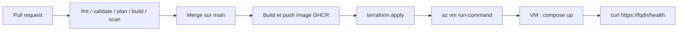

# Démo — conteneurisation d'une application MVC sur Azure

Une application MVC factice, conteneurisée et servie par Traefik, avec
Prometheus, Grafana et cAdvisor pour l'observabilité. L'infrastructure est
décrite en Terraform et déployée par GitHub Actions à chaque merge de pull
request sur `main`.

## Ce que la démo montre

| Brique | Rôle | Où |
|---|---|---|
| Application MVC (ASP.NET Core 10) | Page d'accueil, `/health`, `/metrics` | `app/` |
| Traefik v3 | Reverse proxy, TLS Let's Encrypt, routage déclaratif par labels Docker | `stack/traefik/` |
| socket-proxy | Proxy en lecture seule devant `/var/run/docker.sock` | `stack/docker-compose.yml` |
| Prometheus | Collecte des métriques (5 cibles) | `stack/prometheus/` |
| Grafana | 4 dashboards provisionnés, sous `/grafana/` | `stack/grafana/` |
| cAdvisor | Métriques CPU / mémoire / réseau par conteneur | `stack/docker-compose.yml` |
| node_exporter | Métriques de l'hôte : CPU, mémoire, disques, charge | `stack/docker-compose.yml` |
| Terraform | VNet, NSG, IP publique, VM, disque de données, budget | `infra/` |
| GitHub Actions | Contrôles en PR, déploiement sur `main` | `.github/workflows/` |

## Flux de déploiement



Deux workflows :

- `pr.yml` : `terraform fmt -check`, `validate`, `plan` commenté dans la PR,
  build Docker sans push, validation du compose et des YAML, scan Trivy de
  l'image et des fichiers d'infrastructure.
- `deploy.yml` : build et push de l'image taguée `${GITHUB_SHA}`, `terraform apply`,
  réécriture du `.env` de la VM (paramètre protégé), `docker compose up -d`,
  test de fumée HTTPS qui vérifie aussi que `/metrics` reste fermé.

Aucune clé SSH n'est exposée et aucun port d'administration n'est ouvert : le
déploiement passe par `az vm run-command`. L'authentification Azure utilise
OIDC (identité fédérée GitHub), sans secret de client.

## Prérequis

- Une souscription Azure et la CLI `az` connectée (`az login`).
- `terraform >= 1.9`, `docker` avec le plugin compose, `gh` authentifié.
- Un dépôt GitHub public (les workflows lisent `vars.*` ; aucun secret en clair).

## Mise en route

### 1. Bootstrap Azure (une seule fois, hors CI)

```bash
./infra/bootstrap/bootstrap.sh
```

Le script crée le stockage d'état Terraform, le groupe de ressources, l'app
registration avec ses deux identifiants fédérés (`pull_request` et
`environment:production`), les rôles minimaux, puis affiche les commandes
`gh variable set` à exécuter. Il est rejouable sans effet de bord.

### 2. Variables et secret GitHub

```bash
gh variable set AZURE_CLIENT_ID       --repo adam-benyekkou/demo-cours-docker-intro --body "<appId>"
gh variable set AZURE_TENANT_ID       --repo adam-benyekkou/demo-cours-docker-intro --body "<tenantId>"
gh variable set AZURE_SUBSCRIPTION_ID --repo adam-benyekkou/demo-cours-docker-intro --body "<subscriptionId>"
gh variable set TF_STATE_RESOURCE_GROUP  --repo adam-benyekkou/demo-cours-docker-intro --body "rg-tfstate"
gh variable set TF_STATE_STORAGE_ACCOUNT --repo adam-benyekkou/demo-cours-docker-intro --body "tfstate<xxxxxx>"
gh variable set ADMIN_SSH_PUBLIC_KEY  --repo adam-benyekkou/demo-cours-docker-intro --body "$(cat ~/.ssh/id_ed25519.pub)"
gh variable set BUDGET_CONTACT_EMAILS --repo adam-benyekkou/demo-cours-docker-intro --body '["vous@example.com"]'
gh secret   set GRAFANA_ADMIN_PASSWORD --repo adam-benyekkou/demo-cours-docker-intro
```

`ADMIN_SSH_PUBLIC_KEY` est une clé de secours : aucun port SSH n'est ouvert, le
déploiement passe par `run-command`. Seule la clé publique est stockée ; il n'y
a plus de clé privée dans l'état Terraform.

Sans `BUDGET_CONTACT_EMAILS`, le budget n'est pas créé (Azure exige au moins un
destinataire pour une alerte).

Restreindre le déploiement à `main` : seul ce branchement obtient le jeton OIDC
de l'environnement `production`.

```bash
gh api -X PUT repos/adam-benyekkou/demo-cours-docker-intro/environments/production \
  -f 'deployment_branch_policy[protected_branches]=false' \
  -f 'deployment_branch_policy[custom_branch_policies]=true'
gh api -X POST repos/adam-benyekkou/demo-cours-docker-intro/environments/production/deployment-branch-policies \
  -f name=main
```

Le package GHCR doit être public pour que la VM puisse le tirer sans
authentification :

```bash
gh api -X PATCH /user/packages/container/demo-cours-docker-intro%2Fapp -f visibility=public
```

Aucun email de compte Let's Encrypt n'est configuré : Traefik émet quand même
les certificats, mais sans notification d'expiration. Pour l'ajouter, renseigner
`certificatesResolvers.le.acme.email` dans `stack/traefik/traefik.yml` (la
configuration statique est un fichier unique, Traefik refuse de la mélanger à
des options CLI).

### 3. Premier déploiement

Merger une pull request sur `main`. Le workflow `Deploy` provisionne
l'infrastructure, publie l'image et démarre la stack sur la VM. L'URL est
`https://<dns_label>.<region>.cloudapp.azure.com`.

Attention au premier `apply` après adoption de `ADMIN_SSH_PUBLIC_KEY` :
`admin_ssh_key` est `ForceNew` dans azurerm 5.x, donc **la VM est détruite et
recréée**. Le disque `/data` (état Traefik, Prometheus, Grafana, certificats) et
l'IP publique sont des ressources séparées : ils survivent, le FQDN ne change
pas, mais le site est indisponible le temps d'un redéploiement. Vérifier avant
de merger :

```bash
cd infra && terraform plan | grep -E 'must be replaced|admin_ssh_key'
```

Ensuite, les déploiements suivants ne touchent plus à la VM.

## Test local, sans Azure

```bash
docker build -t demo-cours-app:local app/
./stack/local-tls.sh        # certificat auto-signé + secret Grafana
cd stack
cp .env.example .env        # APP_IMAGE=demo-cours-app, APP_IMAGE_TAG=local
docker compose --env-file .env -f docker-compose.yml -f docker-compose.local.yml up -d
```

La surcharge locale utilise des volumes nommés, un certificat auto-signé et les
ports `18080`/`18443` (les ports 80/443 de la machine hôte sont souvent occupés
par d'autres conteneurs de cours). `local-tls.sh` génère aussi
`stack/secrets/grafana_admin_password`, le fichier que Grafana monte.

```bash
curl -s -o /dev/null -w '%{http_code}\n' -H 'Host: app.localhost' http://127.0.0.1:18080/health  # 301
curl -fsk -H 'Host: app.localhost' https://127.0.0.1:18443/health                                # 200
curl -sk -o /dev/null -w '%{http_code}\n' -H 'Host: app.localhost' https://127.0.0.1:18443/metrics  # 404
```

Prometheus n'est pas publié : on l'interroge depuis son conteneur.

```bash
docker compose --env-file .env -f docker-compose.yml -f docker-compose.local.yml \
  exec prometheus wget -qO- http://127.0.0.1:9090/api/v1/targets
```

## Choix d'architecture

Une VM Linux avec Docker Compose, et non ACI, Container Apps ou AKS : Traefik a
besoin du provider Docker et cAdvisor a besoin de l'hôte (`/sys`, `/var/lib/docker`).
ACI n'offre pas de montage hôte, Container Apps impose son propre ingress, AKS
est hors proportion pour une démo.

Le routage est déclaratif : Traefik lit les labels du compose, `exposedByDefault`
est à `false`, et la redirection HTTP → HTTPS vit dans un provider fichier pour
ne pas casser le challenge ACME HTTP-01. Le résolveur ACME est configuré une
seule fois sur l'entrypoint `websecure`.

Trois réseaux sont épinglés dans le compose :

- `edge` (`10.89.0.0/24`) : Traefik, l'application, Grafana. L'application ne
  fait confiance qu'à ce sous-réseau pour `X-Forwarded-*`.
- `monitoring` (`10.89.1.0/24`) : Prometheus, cAdvisor, node_exporter.
- `socket` (interne, `10.89.2.0/24`) : socket-proxy et Traefik uniquement.

Images épinglées : `traefik:v3.8.0`, `prom/prometheus:v3.16.0`,
`grafana/grafana:13.2.6`, `gcr.io/cadvisor/cadvisor:v0.55.1`,
`tecnativa/docker-socket-proxy:3.4`. Dependabot suit ces versions, les images
Docker et les actions GitHub.

## Coûts

Facturation à l'usage, sans engagement : la VM est facturée à la seconde tant
qu'elle est **allouée**. Un arrêt depuis l'OS ne suffit pas, il faut
`az vm deallocate`. Disques et IP statique restent facturés même VM éteinte.

Le budget Terraform (`infra/budget.tf`) alerte à 50 % et 90 % du réalisé, et à
100 % du prévisionnel. C'est une alerte, pas un plafond : Azure ne coupe rien.

```bash
az vm deallocate -g rg-demo-docker -n democours-vm   # hors session de cours
```

## Sécurité

- NSG : seuls 80 et 443 entrants, aucun port d'administration.
- Traefik n'accède au socket Docker qu'à travers `tecnativa/docker-socket-proxy`
  en lecture seule (`POST=0`), sur un réseau interne où aucune application
  n'est présente.
- L'environnement GitHub `production` n'accepte que le branchement `main` :
  une branche ne peut pas obtenir le jeton OIDC de déploiement.
- Le `.env` de la VM est un paramètre protégé de `run-command` : sa valeur
  n'apparaît ni dans les logs du job, ni dans l'historique de la commande.
- Grafana lit son mot de passe dans un fichier monté (`/run/secrets`, 0400) :
  il n'est jamais dans l'environnement du conteneur, donc jamais dans
  `docker inspect`.
- En-têtes de sécurité et limite de débit sur Grafana : `stack/traefik/dynamic/security.yml`.
- Conteneurs applicatifs : `cap_drop: ALL`, `no-new-privileges`, `read_only` +
  `tmpfs` ; Traefik ne garde que `NET_BIND_SERVICE`.
- Prometheus, cAdvisor et le dashboard Traefik ne sont jamais publiés.
- `/metrics` reste interne : le routeur public l'exclut, Prometheus l'appelle
  directement sur le réseau Docker. Le test de fumée vérifie le 404 public.
- Le dashboard Traefik est désactivé (`api` absent de `traefik.yml`), il ne
  reste que l'endpoint de santé interne.
- L'état Terraform vit dans un compte de stockage versionné, sans clé de compte
  (`use_azuread_auth`), avec un rôle `Storage Blob Data Contributor` limité à ce
  compte.
- `trivy config` bloque la CI sur les misconfigurations HIGH/CRITICAL ; les
  exceptions assumées sont dans `.trivyignore.yaml`, avec leur justification.

## Limites connues

- cAdvisor garde un accès direct à `/var/run/docker.sock` : depuis la v0.53.0,
  sa fabrique Docker ouvre aussi le socket gRPC de containerd, qu'un proxy HTTP
  (`docker-socket-proxy`) ne peut pas fournir. Un cAdvisor compromis reste donc
  équivalent à root sur l'hôte. Le reste de la stack n'a pas cet accès.
- Les métriques par conteneur de cAdvisor dépendent du moteur Docker de l'hôte
  (cgroups v2 / snapshotters containerd) ; à vérifier sur la VM après un
  changement de version de Docker.
- cAdvisor tourne sans `CAP_SYSLOG` (`cap_drop: ALL`) : sous Ubuntu, où
  `dmesg_restrict` vaut 1, la lecture de `/dev/kmsg` échoue et le watcher OOM
  est désactivé. Les métriques CPU/mémoire/réseau ne sont pas affectées.
- Un PR de même dépôt obtient le jeton OIDC avec `Contributor` sur le groupe de
  ressources : il pourrait modifier le workflow. Acceptable tant qu'un seul
  auteur peut pousser ; une app registration en lecture seule pour les PR serait
  nécessaire sinon.
- `Standard_B2s` (4 Go) héberge sept conteneurs : confortable pour la démo,
  juste si Grafana et l'application travaillent en même temps.
- La première émission Let's Encrypt utilise la production ; en cas d'échecs
  répétés, basculer l'ACME sur le répertoire staging.
- Pas de CSP : les pages Grafana utilisent scripts et styles inline.
- Le navigateur garde HSTS pour le domaine pendant un an (`preload`) : un retour
  en HTTP local sur ce nom de domaine échouera.

## Dépannage

| Symptôme | Piste |
|---|---|
| `terraform apply` : `AuthorizationFailed` sur le budget | Le SP n'a pas `Microsoft.Consumption/budgets/write` ; vérifier `Contributor` sur le RG |
| `terraform apply` : valeur manquante pour `admin_ssh_public_key` | Renseigner la variable GitHub `ADMIN_SSH_PUBLIC_KEY` |
| Traefik renvoie 404 sur le domaine | Labels absents ou provider Docker muet ; `docker compose logs traefik` |
| Certificat Let's Encrypt en échec | Le DNS doit résoudre avant l'émission ; les logs Traefik nomment le challenge |
| Grafana en 502 au premier démarrage | Migrations SQLite : environ 30 s avant que le port 3000 réponde |
| Grafana refuse de démarrer : mot de passe illisible | Le fichier `stack/secrets/grafana_admin_password` doit appartenir à 472:472 en 0400 (le script de déploiement le fait) |
| `docker compose` : secret file not found | Lancer `./stack/local-tls.sh` avant `up` |
| `terraform plan` veut remplacer la VM | `custom_data` a changé ; il est ignoré par `lifecycle` mais un changement volontaire de cloud-init impose un remplacement |
