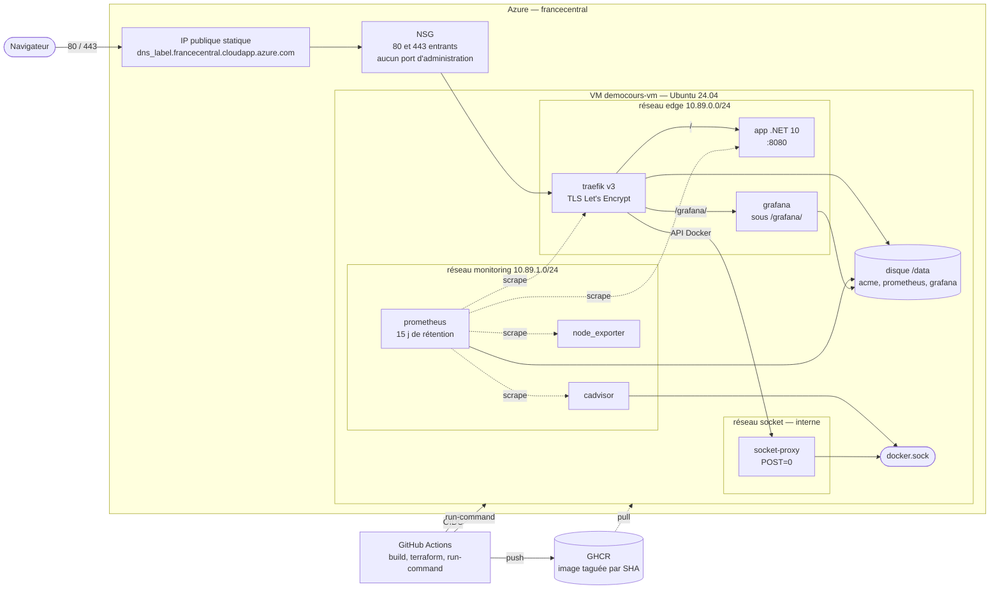
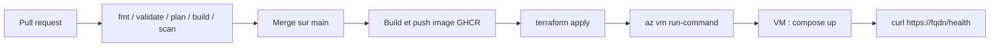

# Démo — conteneurisation d'une application MVC sur Azure

Une application MVC factice, conteneurisée et servie par Traefik, avec
Prometheus, Grafana et cAdvisor pour l'observabilité. L'infrastructure est
décrite en Terraform et déployée par GitHub Actions à chaque merge sur `main`.

Suite du document : [exploitation](docs/exploitation.md) (choix d'architecture,
coûts, dépannage) et [sécurité](docs/securite.md) (mesures en place, limites
connues).

## Ce que la démo montre

| Brique | Rôle | Où |
|---|---|---|
| Application MVC (ASP.NET Core 10) | Page d'accueil, `/health`, `/metrics` | `app/` |
| Traefik v3 | Reverse proxy, TLS Let's Encrypt, routage déclaratif par labels Docker | `stack/traefik/` |
| socket-proxy | Proxy en lecture seule devant `/var/run/docker.sock` | `stack/docker-compose.yml` |
| Prometheus | Collecte des métriques (5 cibles) | `stack/prometheus/` |
| Grafana | 4 dashboards provisionnés, sous `/grafana/` | `stack/grafana/` |
| cAdvisor | Métriques CPU / mémoire / réseau par conteneur | `stack/docker-compose.yml` |
| node_exporter | Métriques de l'hôte : CPU, mémoire, disques, charge | `stack/docker-compose.yml` |
| Terraform | VNet, NSG, IP publique, VM, disque de données, budget | `infra/` |
| GitHub Actions | Contrôles en PR, déploiement sur `main` | `.github/workflows/` |

## Carte du dépôt

```
.
├── app/                         application ASP.NET Core, l'image déployée
│   ├── Dockerfile               build multi-étapes, utilisateur non-root
│   ├── Program.cs               pipeline HTTP, /health, /metrics, X-Forwarded-*
│   └── Views/Home/Index.cshtml  page d'accueil, témoin du test de fumée
├── stack/                       ce qui tourne sur la VM
│   ├── docker-compose.yml       les sept services et les trois réseaux
│   ├── docker-compose.local.yml surcharge du test local (ports 18080/18443)
│   ├── .env.example             contrat unique : image, domaine, mot de passe
│   ├── local-tls.sh             certificat auto-signé et secret Grafana locaux
│   ├── traefik/                 configuration statique, dynamique, middlewares
│   ├── prometheus/              configuration de collecte
│   └── grafana/                 provisioning et quatre dashboards
├── infra/                       infrastructure Azure (Terraform)
│   ├── bootstrap/bootstrap.sh   à lancer une fois : état, app registration, rôles
│   ├── versions.tf, backend.tf  versions et état distant
│   ├── variables.tf             toutes les variables et leurs valeurs par défaut
│   ├── network.tf, vm.tf, disk.tf  VNet, NSG, IP publique, VM, disque /data
│   ├── cloud-init.yml           préparation de l'hôte au premier démarrage
│   └── budget.tf                alerte de consommation à 50 / 90 / 100 %
├── scripts/
│   ├── vm-deploy.sh             exécuté sur la VM par la CI (run-command)
│   └── check-yaml.py            parse tous les YAML, tags Compose compris
├── .github/
│   ├── workflows/pr.yml         fmt, validate, plan, build, scans Trivy
│   ├── workflows/deploy.yml     build + push, apply, déploiement, test de fumée
│   └── dependabot.yml           versions des images, actions et provider
├── docs/
│   ├── exploitation.md          choix d'architecture, coûts, dépannage
│   └── securite.md              mesures en place et limites connues
└── .trivyignore.yaml            exceptions de scan, chacune justifiée
```

## Infrastructure



Seuls 80 et 443 sont joignables depuis Internet, et c'est la seule brèche
ouverte : le reste est détaillé dans [la page sécurité](docs/securite.md).

## Flux de déploiement



Deux workflows :

- `pr.yml` : `terraform fmt -check`, `validate`, `plan` commenté dans la PR,
  build Docker sans push, validation du compose et des YAML, scan Trivy de
  l'image et des fichiers d'infrastructure.
- `deploy.yml` : build et push de l'image taguée `${GITHUB_SHA}`, `terraform
  apply`, réécriture du `.env` de la VM (paramètre protégé), `docker compose up
  -d`, test de fumée HTTPS qui vérifie aussi que `/metrics` reste fermé.

Aucune clé SSH n'est exposée et aucun port d'administration n'est ouvert : le
déploiement passe par `az vm run-command`. L'authentification Azure utilise OIDC
(identité fédérée GitHub), sans secret de client.

## Prérequis

- Une souscription Azure et la CLI `az` connectée (`az login`).
- `terraform >= 1.9`, `docker` avec le plugin compose, `gh` authentifié.
- Un dépôt GitHub public (les workflows lisent `vars.*` ; aucun secret en clair).

## Mise en route

### 1. Bootstrap Azure (une seule fois, hors CI)

```bash
./infra/bootstrap/bootstrap.sh
```

Le script crée le stockage d'état Terraform, le groupe de ressources, l'app
registration avec ses deux identifiants fédérés (`pull_request` et
`environment:production`), les rôles minimaux, puis affiche les commandes
`gh variable`, `gh secret` et `gh api` à exécuter. **Ce bloc affiché est la
référence** ; il est rejouable sans effet de bord.

Trois points qu'il ne peut pas décider à ta place :

- `GRAFANA_ADMIN_PASSWORD` est le seul secret GitHub (`gh secret set` demande la
  valeur au prompt, hors historique du shell).
- `ADMIN_SSH_PUBLIC_KEY` est une clé de secours : aucun port SSH n'est ouvert,
  le déploiement passe par `run-command`. Seule la clé publique est stockée.
- Sans `BUDGET_CONTACT_EMAILS`, le budget n'est pas créé : Azure exige au moins
  un destinataire pour une alerte.

### 2. Premier déploiement

Merger une pull request sur `main`. Le workflow `Deploy` provisionne
l'infrastructure, publie l'image et démarre la stack sur la VM. L'URL est
`https://<dns_label>.<region>.cloudapp.azure.com`.

Attention au premier `apply` après adoption de `ADMIN_SSH_PUBLIC_KEY` :
`admin_ssh_key` est `ForceNew` dans azurerm 5.x, donc **la VM est détruite et
recréée**. Le disque `/data` (état Traefik, Prometheus, Grafana, certificats) et
l'IP publique sont des ressources séparées : ils survivent, le FQDN ne change
pas, mais le site est indisponible le temps d'un redéploiement. Vérifier avant
de merger :

```bash
cd infra && terraform plan | grep -E 'must be replaced|admin_ssh_key'
```

Ensuite, les déploiements suivants ne touchent plus à la VM.

## Test local, sans Azure

```bash
docker build -t demo-cours-app:local app/
./stack/local-tls.sh        # certificat auto-signé + secret Grafana
cd stack
cp .env.example .env        # APP_IMAGE=demo-cours-app, APP_IMAGE_TAG=local
docker compose --env-file .env -f docker-compose.yml -f docker-compose.local.yml up -d
```

La surcharge locale utilise des volumes nommés, un certificat auto-signé et les
ports `18080`/`18443` (les ports 80/443 de la machine hôte sont souvent occupés
par d'autres conteneurs de cours). `local-tls.sh` génère aussi
`stack/secrets/grafana_admin_password`, le fichier que Grafana monte.

```bash
curl -s -o /dev/null -w '%{http_code}\n' -H 'Host: app.localhost' http://127.0.0.1:18080/health  # 301
curl -fsk -H 'Host: app.localhost' https://127.0.0.1:18443/health                                # 200
curl -sk -o /dev/null -w '%{http_code}\n' -H 'Host: app.localhost' https://127.0.0.1:18443/metrics  # 404
```

Prometheus n'est pas publié : on l'interroge depuis son conteneur.

```bash
docker compose --env-file .env -f docker-compose.yml -f docker-compose.local.yml \
  exec prometheus wget -qO- http://127.0.0.1:9090/api/v1/targets
```

## Conventions

- **Langue.** Ce README, `stack/` et `docs/` sont en français : c'est ce qu'un
  lecteur ouvre pour comprendre la démo. `infra/`, `scripts/`, `.github/` et
  `app/` commentent en anglais, comme le code qu'ils accompagnent.
- **Un fait, un endroit.** Les commandes `gh` ne vivent que dans la sortie de
  `bootstrap.sh`. La sécurité ne vit que dans `docs/securite.md`. Le reste du
  dépôt renvoie vers ces sources au lieu de les recopier.
- **Une vérification locale.** `python3 -I scripts/check-yaml.py` parse tous les
  YAML, tags Compose compris ; `terraform -chdir=infra fmt -check -recursive`
  tient le HCL aligné.
