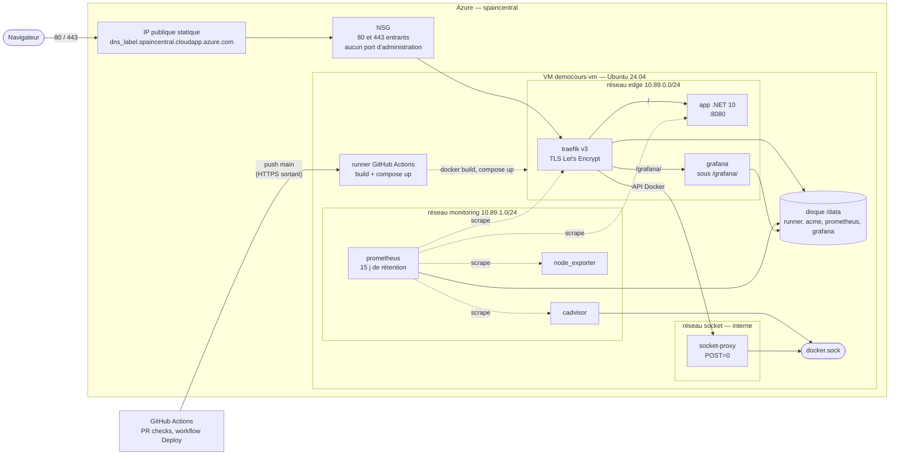
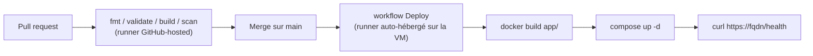

# Démo — conteneurisation d'une application MVC sur Azure

Une application MVC factice, conteneurisée et servie par Traefik, avec
Prometheus, Grafana et cAdvisor pour l'observabilité. L'infrastructure est
décrite en Terraform, et GitHub Actions déploie sur la VM depuis un runner
auto-hébergé installé dessus, à chaque merge sur `main`.

Suite du document : [exploitation](docs/exploitation.md) (choix d'architecture,
coûts, dépannage) et [sécurité](docs/securite.md) (mesures en place, limites
connues).

## Ce que la démo montre

| Brique | Rôle | Où |
|---|---|---|
| Application MVC (ASP.NET Core 10) | Page d'accueil, `/health`, `/metrics` | `app/` |
| Traefik v3 | Reverse proxy, TLS Let's Encrypt, routage déclaratif par labels Docker | `stack/traefik/` |
| socket-proxy | Proxy en lecture seule devant `/var/run/docker.sock` | `stack/docker-compose.yml` |
| Prometheus | Collecte des métriques (5 cibles) | `stack/prometheus/` |
| Grafana | 4 dashboards provisionnés, sous `/grafana/` | `stack/grafana/` |
| cAdvisor | Métriques CPU / mémoire / réseau par conteneur | `stack/docker-compose.yml` |
| node_exporter | Métriques de l'hôte : CPU, mémoire, disques, charge | `stack/docker-compose.yml` |
| Terraform | VNet, NSG, IP publique, VM, disque de données, budget | `infra/` |
| Runner auto-hébergé | Construit l'image et démarre la stack depuis la VM | `scripts/runner-install.sh` |
| GitHub Actions | Contrôles en PR, déploiement sur `main` | `.github/workflows/` |

## Carte du dépôt

```
.
├── app/                         application ASP.NET Core, l'image déployée
│   ├── Dockerfile               build multi-étapes, utilisateur non-root
│   ├── Program.cs               pipeline HTTP, /health, /metrics, X-Forwarded-*
│   └── Views/Home/Index.cshtml  page d'accueil, témoin du test de fumée
├── stack/                       ce qui tourne sur la VM
│   ├── docker-compose.yml       les sept services et les trois réseaux
│   ├── docker-compose.local.yml surcharge du test local (ports 18080/18443)
│   ├── .env.example             contrat unique : image, domaine, mot de passe
│   ├── local-tls.sh             certificat auto-signé et secret Grafana locaux
│   ├── traefik/                 configuration statique, dynamique, middlewares
│   ├── prometheus/              configuration de collecte
│   └── grafana/                 provisioning et quatre dashboards
├── infra/                       infrastructure Azure (Terraform)
│   ├── bootstrap/bootstrap.sh   à lancer une fois : compte d'état et groupes de ressources
│   ├── versions.tf, backend.tf  versions et état distant
│   ├── variables.tf             toutes les variables et leurs valeurs par défaut
│   ├── network.tf, vm.tf, disk.tf  VNet, NSG, IP publique, VM, disque /data
│   ├── cloud-init.yml           préparation de l'hôte au premier démarrage
│   └── budget.tf                alerte de consommation à 50 / 90 / 100 %
├── scripts/
│   ├── runner-install.sh        installe le runner auto-hébergé sur la VM
│   └── check-yaml.py            parse tous les YAML, tags Compose compris
├── .github/
│   ├── workflows/pr.yml         fmt, validate, build, scans Trivy
│   ├── workflows/deploy.yml     build sur la VM, compose up, test de fumée
│   └── dependabot.yml           versions des images, actions et provider
├── docs/
│   ├── exploitation.md          choix d'architecture, coûts, dépannage
│   └── securite.md              mesures en place et limites connues
└── .trivyignore.yaml            exceptions de scan, chacune justifiée
```

## Infrastructure



Seuls 80 et 443 sont joignables depuis Internet, et c'est la seule brèche
ouverte (le runner sort vers github.com, rien n'entre par lui) : le reste est détaillé dans [la page sécurité](docs/securite.md).

## Flux de déploiement



Deux workflows :

- `pr.yml` : `terraform fmt -check`, `validate`, build Docker sans push,
  validation du compose et des YAML, scan Trivy de l'image et des fichiers
  d'infrastructure. Tout tourne sur `ubuntu-latest`.
- `deploy.yml` : sur `push` vers `main` uniquement, sur le runner de la VM :
  écriture du `.env`, `docker build`, `compose up -d`, test de fumée HTTPS qui
  vérifie aussi que `/metrics` reste fermé.

Aucun identifiant Azure n'est stocké dans GitHub : le déploiement ne parle pas à
l'API Azure, il s'exécute sur la machine qui l'héberge. Terraform est appliqué à
la main, avec ton propre `az login`. Pourquoi ce choix : voir
[exploitation](docs/exploitation.md).

## Prérequis

- Une souscription Azure et la CLI `az` connectée (`az login`).
- `terraform >= 1.9`, `docker` avec le plugin compose, `gh` authentifié.
- Une clé SSH publique : Azure exige une méthode d'authentification sur la VM,
  même sans port 22 ouvert. Elle ne sert qu'en secours.
- Un dépôt GitHub public (les workflows lisent `vars.*` ; aucun secret en clair).

## Mise en route

### 1. Bootstrap Azure (une seule fois, hors CI)

```bash
./infra/bootstrap/bootstrap.sh
```

Le script crée le groupe de ressources d'état, le compte de stockage versionné
et son conteneur, puis `rg-demo-docker`. Il ne crée **aucune identité Azure**.
Son affichage final donne les commandes suivantes ; il est rejouable sans effet
de bord.

### 2. Terraform (à la main)

```bash
cd infra
cp terraform.tfvars.example terraform.tfvars   # renseigner admin_ssh_public_key
terraform init \
  -backend-config="resource_group_name=rg-tfstate" \
  -backend-config="storage_account_name=<tfstate-xxxxxx>"
terraform apply
```

Ton compte a besoin de `Storage Blob Data Contributor` sur le compte d'état. Lire
le plan avant d'appliquer. La région et la taille de VM par défaut sont celles
qui passent sur un abonnement Azure for Students (voir
[exploitation](docs/exploitation.md)).

### 3. Variable et secret GitHub

```bash
gh variable set DOMAIN --body "$(terraform -chdir=infra output -raw fqdn)"
gh secret   set GRAFANA_ADMIN_PASSWORD
```

`GRAFANA_ADMIN_PASSWORD` est le seul secret GitHub (`gh secret set` demande la
valeur au prompt, hors historique du shell).

### 4. Runner auto-hébergé sur la VM

```bash
TOKEN=$(gh api -X POST repos/<owner>/<repo>/actions/runners/registration-token --jq .token)
az vm run-command invoke -g rg-demo-docker -n democours-vm \
  --command-id RunShellScript --scripts @scripts/runner-install.sh \
  --parameters "<owner>/<repo>" "$TOKEN"
gh api repos/<owner>/<repo>/actions/runners --jq '.runners[] | "\(.name) \(.status)"'
```

Le runner s'installe sous `/data/actions-runner` avec le label `democours`. Le
token expire en une heure.

### 5. Premier déploiement

Un push sur `main` déclenche `Deploy` sur le runner. L'URL est `https://<DOMAIN>`.

## Explorer les services

Une fois `Deploy` vert, tout passe par `https://<DOMAIN>` (la valeur de la
variable GitHub `DOMAIN`, soit `terraform -chdir=infra output -raw fqdn`). Le
certificat est un vrai Let's Encrypt ; il est émis à la première requête
après le démarrage, soit quelques secondes. Un avertissement « certificat
auto-signé » dans les premières minutes est le certificat par défaut de Traefik :
recharger la page.

| URL | Ce qu'on voit | Attendu |
|---|---|---|
| `/` | Page « Bonjour depuis le conteneur » : nom du conteneur, version = SHA du commit, uptime, adresse client vue par l'appli | 200 |
| `/health` | JSON `{"status":"Healthy", ...}` | 200 |
| `/metrics` | Métriques Prometheus de l'application | **404** : volontairement fermé au public |
| `/grafana/` | Connexion Grafana : utilisateur `admin`, mot de passe = celui donné à `gh secret set GRAFANA_ADMIN_PASSWORD` (GitHub ne le relit jamais) | 200 |
| `/grafana/metrics` | Métriques internes de Grafana | pas 200 : désactivées |

Les quatre dashboards sont dans le dossier « Démo Docker » de Grafana :

| Dashboard | Source | À regarder |
|---|---|---|
| Démo — Application (HTTP) | `/metrics` de l'appli | requêtes par code, latence p95 : recharger `/` plusieurs fois et voir la courbe monter |
| Démo — Traefik | Traefik (`:8082`, interne) | trafic par routeur (`app`, `grafana`) |
| Démo — Hôte (node_exporter) | node_exporter | CPU, mémoire, disques, charge de la VM |
| Démo — Conteneurs (cAdvisor) | cAdvisor | **vide pour l'instant**, voir [sécurité](docs/securite.md) (limites connues) |

Pour générer du trafic visible dans les dashboards :

```bash
for i in $(seq 1 200); do curl -s -o /dev/null https://<DOMAIN>/; done
```

Prometheus, cAdvisor, node_exporter et le socket-proxy ne sont **pas publiés** :
aucun port 9090, aucune URL. Pour interroger Prometheus, passer par la VM :

```bash
az vm run-command invoke -g rg-demo-docker -n democours-vm --command-id RunShellScript \
  --scripts "cd /data/actions-runner/_work/*/*/stack && docker compose --env-file .env -f docker-compose.yml exec -T prometheus wget -qO- http://127.0.0.1:9090/api/v1/targets" \
  --query 'value[0].message' -o tsv
```

Les cinq cibles (`app`, `traefik`, `cadvisor`, `node`, `prometheus`) doivent être
`up`. Dans Grafana, la même information est dans Explorer avec la requête `up`.

Vérifier d'un coup depuis un terminal :

```bash
B=https://<DOMAIN>
for p in / /health /metrics /grafana/login; do printf '%s %s\n' $p "$(curl -s -o /dev/null -w '%{http_code}' $B$p)"; done
# attendu : 200, 200, 404, 200
```

## Test local, sans Azure

```bash
docker build -t demo-cours-app:local app/
./stack/local-tls.sh        # certificat auto-signé + secret Grafana
cd stack
cp .env.example .env        # APP_IMAGE=demo-cours-app, APP_IMAGE_TAG=local
docker compose --env-file .env -f docker-compose.yml -f docker-compose.local.yml up -d
```

La surcharge locale utilise des volumes nommés, un certificat auto-signé et les
ports `18080`/`18443` (les ports 80/443 de la machine hôte sont souvent occupés
par d'autres conteneurs de cours). `local-tls.sh` génère aussi
`stack/secrets/grafana_admin_password`, le fichier que Grafana monte.

```bash
curl -s -o /dev/null -w '%{http_code}\n' -H 'Host: app.localhost' http://127.0.0.1:18080/health  # 301
curl -fsk -H 'Host: app.localhost' https://127.0.0.1:18443/health                                # 200
curl -sk -o /dev/null -w '%{http_code}\n' -H 'Host: app.localhost' https://127.0.0.1:18443/metrics  # 404
```

Prometheus n'est pas publié : on l'interroge depuis son conteneur.

```bash
docker compose --env-file .env -f docker-compose.yml -f docker-compose.local.yml \
  exec prometheus wget -qO- http://127.0.0.1:9090/api/v1/targets
```

## Conventions

- **Langue.** Ce README, `stack/` et `docs/` sont en français : c'est ce qu'un
  lecteur ouvre pour comprendre la démo. `infra/`, `scripts/`, `.github/` et
  `app/` commentent en anglais, comme le code qu'ils accompagnent.
- **Un fait, un endroit.** Les commandes `gh` ne vivent que dans la sortie de
  `bootstrap.sh`. La sécurité ne vit que dans `docs/securite.md`. Le reste du
  dépôt renvoie vers ces sources au lieu de les recopier.
- **Une vérification locale.** `python3 -I scripts/check-yaml.py` parse tous les
  YAML, tags Compose compris ; `terraform -chdir=infra fmt -check -recursive`
  tient le HCL aligné.
