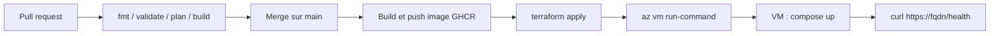

# Démo — conteneurisation d'une application MVC sur Azure

Une application MVC factice, conteneurisée et servie par Traefik, avec
Prometheus, Grafana et cAdvisor pour l'observabilité. L'infrastructure est
décrite en Terraform et déployée par GitHub Actions à chaque merge de pull
request sur `main`.

## Ce que la démo montre

| Brique | Rôle | Où |
|---|---|---|
| Application MVC (ASP.NET Core 8) | Page d'accueil, `/health`, `/metrics` | `app/` |
| Traefik v3 | Reverse proxy, TLS Let's Encrypt, routage déclaratif par labels Docker | `stack/traefik/` |
| socket-proxy | Proxy en lecture seule devant `/var/run/docker.sock` | `stack/docker-compose.yml` |
| Prometheus | Collecte des métriques (5 cibles) | `stack/prometheus/` |
| Grafana | 4 dashboards provisionnés, sous `/grafana/` | `stack/grafana/` |
| cAdvisor | Métriques CPU / mémoire / réseau par conteneur | `stack/docker-compose.yml` |
| node_exporter | Métriques de l'hôte : CPU, mémoire, disques, charge | `stack/docker-compose.yml` |
| Terraform | VNet, NSG, IP publique, VM, disque de données, budget | `infra/` |
| GitHub Actions | Contrôles en PR, déploiement sur `main` | `.github/workflows/` |

## Flux de déploiement



Deux workflows :

- `pr.yml` : `terraform fmt -check`, `validate`, `plan` commenté dans la PR,
  build Docker sans push, validation du compose et des YAML.
- `deploy.yml` : build et push de l'image taguée `${GITHUB_SHA}`, `terraform apply`,
  réécriture du `.env` de la VM, `docker compose up -d`, test de fumée HTTPS.

Aucune clé SSH n'est exposée et aucun port d'administration n'est ouvert : le
déploiement passe par `az vm run-command`. L'authentification Azure utilise
OIDC (identité fédérée GitHub), sans secret de client.

## Prérequis

- Une souscription Azure et la CLI `az` connectée (`az login`).
- `terraform >= 1.9`, `docker` avec le plugin compose, `gh` authentifié.
- Un dépôt GitHub public (les workflows lisent `vars.*` ; aucun secret en clair).

## Mise en route

### 1. Bootstrap Azure (une seule fois, hors CI)

```bash
./infra/bootstrap/bootstrap.sh
```

Le script crée le stockage d'état Terraform, le groupe de ressources, l'app
registration avec ses deux identifiants fédérés (`main` et `pull_request`), les
rôles minimaux, puis affiche les commandes `gh variable set` à exécuter.
Il est rejouable sans effet de bord.

### 2. Variables et secret GitHub

```bash
gh variable set AZURE_CLIENT_ID       --repo adam-benyekkou/demo-cours-docker-intro --body "<appId>"
gh variable set AZURE_TENANT_ID       --repo adam-benyekkou/demo-cours-docker-intro --body "<tenantId>"
gh variable set AZURE_SUBSCRIPTION_ID --repo adam-benyekkou/demo-cours-docker-intro --body "<subscriptionId>"
gh variable set TF_STATE_RESOURCE_GROUP  --repo adam-benyekkou/demo-cours-docker-intro --body "rg-tfstate"
gh variable set TF_STATE_STORAGE_ACCOUNT --repo adam-benyekkou/demo-cours-docker-intro --body "tfstate<xxxxxx>"
gh variable set BUDGET_CONTACT_EMAILS --repo adam-benyekkou/demo-cours-docker-intro --body '["vous@example.com"]'
gh secret   set GRAFANA_ADMIN_PASSWORD --repo adam-benyekkou/demo-cours-docker-intro
```

Sans `BUDGET_CONTACT_EMAILS`, le budget n'est pas créé (Azure exige au moins un
destinataire pour une alerte).

Le package GHCR doit être public pour que la VM puisse le tirer sans
authentification :

```bash
gh api -X PATCH /user/packages/container/demo-cours-docker-intro%2Fapp -f visibility=public
```

L'email du compte Let's Encrypt n'est pas passé par variable : il vit dans
`stack/traefik/traefik.yml`. Traefik refuse de mélanger configuration statique
fichier et options CLI, et le fichier gagne silencieusement. Sans email, Let's
Encrypt émet quand même le certificat, sans notification d'expiration.

### 3. Premier déploiement

Merger une pull request sur `main`. Le workflow `Deploy` provisionne
l'infrastructure, publie l'image et démarre la stack sur la VM. L'URL est
`https://<dns_label>.<region>.cloudapp.azure.com`.

## Test local, sans Azure

```bash
docker build -t demo-cours-app:local app/
./stack/local-tls.sh
cd stack
cp .env.example .env        # APP_IMAGE=demo-cours-app, APP_IMAGE_TAG=local
docker compose --env-file .env -f docker-compose.yml -f docker-compose.local.yml up -d
```
La surcharge locale utilise des volumes nommés, un certificat auto-signé et les
ports `18080`/`18443` (les ports 80/443 de la machine hôte sont souvent occupés
par d'autres conteneurs de cours).

```bash
curl -sI -H 'Host: app.localhost' http://127.0.0.1:18080/health | head -1   # 308
curl -fsk -H 'Host: app.localhost' https://127.0.0.1:18443/health           # 200
curl -fsk -H 'Host: app.localhost' https://127.0.0.1:18443/metrics | head
```

Prometheus n'est pas publié : on l'interroge depuis son conteneur.

```bash
docker exec prometheus wget -qO- http://127.0.0.1:9090/api/v1/targets
```

## Choix d'architecture

Une VM Linux avec Docker Compose, et non ACI, Container Apps ou AKS : Traefik a
besoin du provider Docker et cAdvisor a besoin de l'hôte (`/sys`, `/var/lib/docker`,
`/dev/disk`). ACI n'offre pas de montage hôte, Container Apps impose son propre
ingress, AKS est hors proportion pour une démo.

Le routage est déclaratif : Traefik lit les labels du compose, `exposedByDefault`
est à `false`, et la redirection HTTP → HTTPS vit dans un provider fichier pour
ne pas casser le challenge ACME HTTP-01.

Images épinglées : `traefik:v3.8.0`, `prom/prometheus:v3.16.0`,
`grafana/grafana:13.2.6`, `gcr.io/cadvisor/cadvisor:v0.55.1`,
`tecnativa/docker-socket-proxy:3.4`.

## Coûts

Facturation à l'usage, sans engagement : la VM est facturée à la seconde tant
qu'elle est **allouée**. Un arrêt depuis l'OS ne suffit pas, il faut
`az vm deallocate`. Disques et IP statique restent facturés même VM éteinte.

Le budget Terraform (`infra/budget.tf`) alerte à 50 % et 90 % du réalisé, et à
100 % du prévisionnel. C'est une alerte, pas un plafond : Azure ne coupe rien.

```bash
az vm deallocate -g rg-demo-docker -n democours-vm   # hors session de cours
```

## Sécurité

- NSG : seuls 80 et 443 entrants, aucun port d'administration.
- Traefik n'accède au socket Docker qu'à travers `tecnativa/docker-socket-proxy`
  en lecture seule (`POST=0`).
- Prometheus, cAdvisor et le dashboard Traefik ne sont jamais publiés.
- `/metrics` reste interne : le routeur public l'exclut, Prometheus l'appelle
  directement sur le réseau Docker.
- Le dashboard Traefik est désactivé (`api` absent de `traefik.yml`), il ne
  reste que l'endpoint de santé interne.
- Grafana : mot de passe injecté par la CI dans `stack/.env` (0600), jamais commité.
- L'état Terraform vit dans un compte de stockage versionné, avec un rôle
  `Storage Blob Data Contributor` limité à ce compte.

## Limites connues

- Le `.env` de la VM est transmis par `az vm run-command` en base64 : masqué dans
  les logs GitHub, mais visible dans l'historique de l'extension côté Azure et
  sur la VM. Pour un usage réel, passer par Key Vault et l'identité managée de la VM.
- Un PR de même dépôt obtient le jeton OIDC avec `Contributor` sur le groupe de
  ressources : il peut modifier le workflow. Une app registration séparée en
  lecture seule pour les PR serait nécessaire en production.
- `Standard_B2s` (4 Go) héberge sept conteneurs : confortable pour la démo,
  juste si Grafana et l'application travaillent en même temps.
- La première émission Let's Encrypt utilise la production ; en cas d'échecs
  répétés, basculer l'ACME sur le répertoire staging.
- Les paramètres du backend sont répétés dans `backend.tf` et dans les deux
  workflows, faute d'un `backend.hcl` partagé.

## Dépannage

| Symptôme | Piste |
|---|---|
| `terraform apply` : `AuthorizationFailed` sur le budget | Le SP n'a pas `Microsoft.Consumption/budgets/write` ; vérifier `Contributor` sur le RG |
| Traefik renvoie 404 sur le domaine | Labels absents ou `traefik.docker.network` incorrect ; `docker inspect traefik` |
| Certificat Let's Encrypt en échec | Le DNS doit résoudre avant l'émission ; les logs Traefik nomment le challenge |
| Grafana en 502 au premier démarrage | Migrations SQLite : environ 30 s avant que le port 3000 réponde |
| `terraform plan` veut remplacer la VM | `custom_data` a changé ; il est ignoré par `lifecycle` mais un changement volontaire de cloud-init impose un remplacement |
